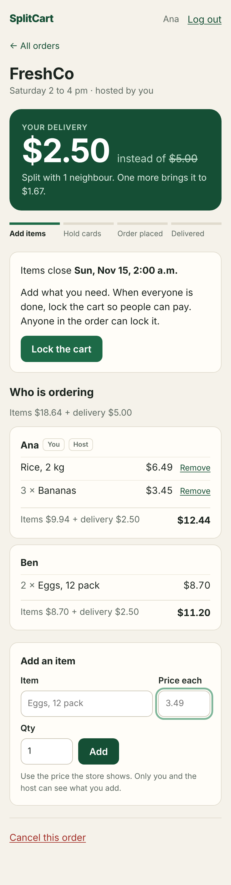
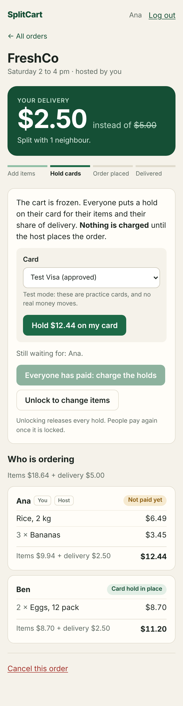

# SplitCart

[](https://github.com/yeshigurmey/splitcart/actions/workflows/ci.yml)

A web app for neighbours in the same building to combine their grocery orders into one delivery and split the delivery fee.

## Why

A delivery fee is a flat cost per drop-off, so on a small order it is a big part of the bill: $5 on a $25 order is 20%. That one number is where a lot of people close the app and walk to the store instead.

When several households in one building order together, one delivery serves all of them and the fee is shared. Four neighbours pay $1.25 each instead of $5.00. SplitCart puts that number at the top of the screen and it drops, live, each time another neighbour adds an item.

<p>
  
  
</p>

## How an order works

```
open  --lock-->  locked  --place-->  placed  --deliver-->  delivered
  ^                |                    |
  +----unlock------+                    |
  |                |                    |
  +----cancel------+-------cancel-------+-->  cancelled
```

1. **Open.** A host starts an order (store, delivery time, cutoff, delivery fee). Neighbours join with the building's code and add items. Everyone sees their share of the fee update live.
2. **Locked.** Anyone in the order can lock the cart. Items freeze, and each person puts a hold on their card for their items plus their fee share. A hold reserves the money without taking it.
3. **Placed.** Once every hold is in, the host captures them and places the real order with the store. The host never fronts money for anyone.
4. **Delivered.** Anyone can mark it delivered when the bags arrive.

Unlocking releases every hold. Cancelling releases holds and refunds anything already captured.

## Run it

Needs Node 20 or newer.

```bash
npm install

npm run dev:server   # terminal 1: the API on http://localhost:3000
npm run dev:web      # terminal 2: the web app on http://localhost:5173
```

Open http://localhost:5173, sign up as the first person in a building, then sign up a second person in a private window using the building code. Put the two windows side by side to watch the live updates.

Out of the box, payments go to a built-in fake provider, so everything works with no accounts or keys. To use Stripe's test mode instead:

```bash
STRIPE_SECRET_KEY=sk_test_your_key npm run dev:server
```

Holds then appear in the Stripe dashboard as uncaptured payments. Only test mode keys are accepted; the server refuses to start with a live key.

Other commands:

```bash
npm test             # 114 tests
npm run typecheck
npm run build        # build the web app into dist/
npm start            # serve the API and the built web app together on one port
```

| Variable | Default | Meaning |
|---|---|---|
| `PORT` | `3000` | Port to listen on |
| `DATABASE_PATH` | `./data/splitcart.db` | SQLite file |
| `STRIPE_SECRET_KEY` | unset | Stripe test key. Unset means the fake provider. |
| `NODE_ENV` | unset | `production` serves `dist/` and makes the session cookie HTTPS-only |

## How the code is organised

```
src/
  split.ts        splitting an amount of cents evenly or in proportion, never losing a cent
  money.ts        "4.99" <-> 499 without floating point
  order.ts        the order model and state machine: pure functions, no I/O
  server/
    db.ts         SQLite schema
    auth.ts       password hashing and session tokens
    payments.ts   the PaymentGateway interface and an in-memory fake
    stripe.ts     the Stripe test mode implementation
    service.ts    every use case: accounts, orders, items, holds, capture, refunds
    events.ts     publish/subscribe for live updates
    app.ts        HTTP routes and server-sent events
    main.ts       reads configuration and starts the server
  web/            the React app
```

The layers only depend downwards. `order.ts` knows nothing about databases, `service.ts` knows nothing about HTTP, and `app.ts` contains no rules. Each request does the same three things: load the order, ask `order.ts` whether the action is allowed, then write.

## Decisions worth explaining

**Money is integer cents everywhere.** `0.1 + 0.2` is not `0.3` in floating point, so amounts are whole numbers of cents from the form field to the database column. When a fee does not divide evenly, the leftover cents are handed out by a fixed rule, and tests check that the shares always add up to exactly the fee.

**Holds first, capture later.** Stripe calls this manual capture: a PaymentIntent is authorized when a neighbour pays and captured only when the host is ready to buy. Until then, backing out costs nobody anything, because releasing a hold is not a refund.

**Every payment call carries an idempotency key.** If a request times out, the server cannot know whether the provider received it. Sending it again with the same key is safe: the provider does the work once and repeats the same answer. A retry after a declined card gets a new key, because the old key would replay the decline.

**Money moves before the status changes.** Placing an order captures each hold and only then marks the order placed. If the provider goes down half way, the order is still locked, and pressing the button again finishes the job: captured payments are skipped, the rest are captured. The same goes for unlocking and cancelling.

**One payment per member per lock, enforced by the database.** A `UNIQUE (order_id, user_id, lock_version)` constraint means a double click cannot create two holds, whatever the application code does.

**Work on one order is queued.** Calls to a payment provider take time, so two requests could otherwise interleave. Each order has its own queue; different orders do not wait for each other.

**The server tells the page what is allowed.** Every order view includes a `can` map (lock, place, hold, and so on) computed from the same rules the server enforces. The page shows or disables buttons from that map and never decides for itself.

**Item details are private.** Neighbours see each other's totals. Only the host, who has to buy the items, sees what they are.

**Live updates use server-sent events.** Each browser keeps one HTTP connection open per order and receives the complete new view whenever anything changes. It is one-way, which is all a live view needs, and simpler than WebSockets.

## How it is tested

- **Rules.** The transition table is checked against every combination of status and action, so there is no path the table does not describe.
- **Money invariants.** Fee shares always add up to the fee, in both split modes, across many amounts.
- **Use cases with a fake provider.** The fake follows the same rules as a real provider and can be told to decline a card or go down at a chosen moment. Tests cover a double-clicked pay button, two people placing at once, a lost reply to a hold request, and an outage half way through capturing, unlocking and cancelling. Each one ends by checking where every cent is.
- **HTTP.** The real server is started on a free port and driven by two cookie-keeping clients, including reading the live stream.
- **Stripe adapter.** A stand-in for `fetch` checks the exact URL, headers, form fields and idempotency key of each request, and how each kind of reply is handled.

## Limitations

This is a learning project, not a product, and these gaps are deliberate or still open:

- **The Stripe adapter has not been run against Stripe yet.** Its tests check requests against Stripe's documented API using a stand-in for the network. It needs a run with a real test key.
- **Test cards only.** People choose from Stripe's test cards. Taking a real card needs Stripe's card form in the browser, which is not built.
- **No payout to the host.** Captured money lands in the platform's Stripe account. Paying it on to the host needs Stripe Connect.
- **Prices are typed in.** There is no link to any store, so totals are estimates, and substitutions or missing items are not handled after the order is placed.
- **Holds expire.** A card hold usually lasts about a week. The app does not track that.
- **Accounts are minimal.** No email verification, password reset or rate limiting on log-in.
- **One server process.** The per-order queue and the live update hub live in memory.
- **Not deployed yet.**

## Tech stack

TypeScript, Node, Express, SQLite (better-sqlite3), React, Vite, Vitest, Stripe PaymentIntents API, GitHub Actions.
